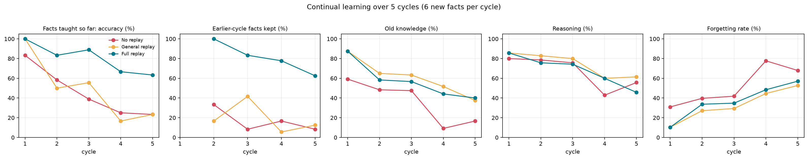

# Sleep-inspired continual learning for a local LLM

A small, honest implementation of the idea in *"Language Models Need Sleep"*: a model **collects experiences while awake**, then **"sleeps"** to consolidate them into a LoRA adapter, and a **champion/candidate gate** decides whether the new adapter may replace the old model.

Runs fully on a MacBook (Apple M2, 16 GB) with **Qwen/Qwen3-4B in full bf16 precision** and **MLX-LM**. Knowledge Seeding and Expandable Experts from the paper are intentionally not implemented.

## How it works

```
 WAKE                                   SLEEP
 chat -> classify -> collect            pick approved experiences
      -> validate (PENDING/APPROVED/    -> generate training questions
         REJECTED) -> SQLite            -> build dataset (+ replay)
                                        -> LoRA train (base frozen)
                                        -> evaluate (220 questions)
                                        -> gate: promote or reject
                                        -> rollback if needed
```

Details: [docs/architecture.md](docs/architecture.md).

## Results (all measured, 220-question exam, base model never modified)

| Model | New facts | Old knowledge | Reasoning | Forgetting | Gate |
|---|---|---|---|---|---|
| A: original Qwen | 0% | 99.2% | 92.9% | - | champion |
| B: Qwen + episodic memory | 100% | 99.2% | 92.9% | 0% | - |
| C: LoRA, no replay | 83.3% | 59.2% | 84.3% | 31.0% | rejected |
| C: LoRA + replay | 86.7% | 93.3% | 84.3% | 7.6% | rejected |

5-cycle study (6 new facts per cycle, one adapter carried forward), after cycle 5:

| Arm | Earlier-cycle facts kept | Old knowledge | Reasoning | Forgetting |
|---|---|---|---|---|
| No replay | 8% | 16.7% | 55.7% | 67.9% |
| General replay | 12.5% | 37.5% | 61.4% | 52.7% |
| Full replay | 62.5% | 40.0% | 45.7% | 57.1% |

**Takeaway:** replaying earlier facts is what keeps learned facts; nothing here stops general knowledge from eroding over cycles, and all 15 study cycles would have failed the promotion gate. Read [docs/limitations.md](docs/limitations.md) before quoting any number.



## Quick start

```bash
python3.11 -m venv .venv && source .venv/bin/activate
pip install -r requirements.txt
python -m pytest -q                          # unit tests
streamlit run dashboard/app.py               # dashboard over the real results
uvicorn api.main:app --port 8000             # read-only API, docs at /docs
python -m scripts.make_figures               # redraw charts from results
```

Reproduce experiments (downloads ~8 GB model on first run; Phase 9 takes several hours):

```bash
python -m experiments.baseline               # A
python -m experiments.episodic_memory        # B
python -m experiments.continual_learning --arm no_replay   # also general_replay, full_replay
```

Other tools: `scripts/chat.py` (wake phase), `scripts/experiences.py` (review stored facts), `scripts/sleep.py` (one sleep cycle), `scripts/evaluate.py`, `scripts/rollback.py`.

## Repository map

`src/wake` chat and collection · `src/validation` approval rules · `src/memory` SQLite and episodic retrieval · `src/sleep` dataset building, replay, controller · `src/training` LoRA trainer · `src/evaluation` benchmarks and metrics · `src/registry` champion, gate, rollback · `experiments/` the three experiments · `dashboard/`, `api/` presentation · `configs/` all settings.
