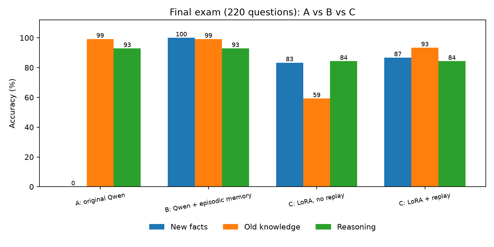
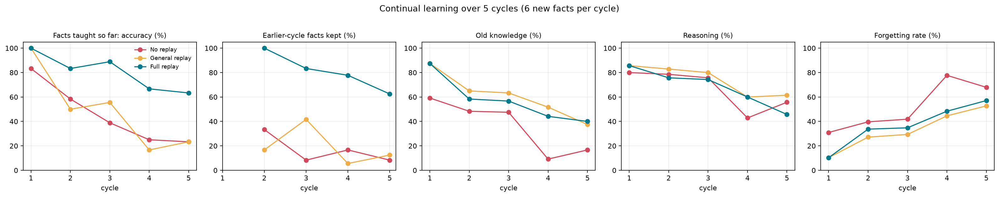
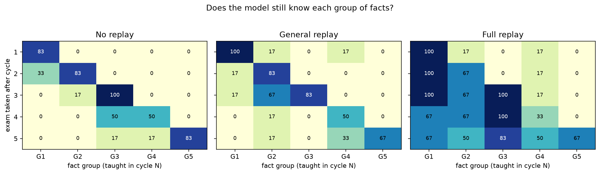

# Experimental results

Generated by `python -m scripts.make_figures` from the files in `experiments/results/`. Nothing here is typed by hand.

## Phase 8: final exam, 220 questions

| model | new_facts | old_knowledge | reasoning | forgetting_rate | median_latency_s | training_seconds | gate |
|---|---|---|---|---|---|---|---|
| A: original Qwen | 0.0% | 99.2% | 92.9% | - | 1.5 | - | champion |
| B: Qwen + episodic memory | 100.0% | 99.2% | 92.9% | 0.0% | 1.6 | - | not trained |
| C: LoRA, no replay | 83.3% | 59.2% | 84.3% | 31.0% | 2.1 | 350.0 | rejected |
| C: LoRA + replay | 86.7% | 93.3% | 84.3% | 7.6% | 1.6 | 593.3 | rejected |

## Dev-set settings (Phase 8 tuning, not the final exam)

| setting | dev_knowledge | dev_reasoning | dev_forgetting | paraphrase_acc | train_examples | training_seconds | selected |
|---|---|---|---|---|---|---|---|
| T0_no_replay | 70.0% | 90.0% | 20.7% | 93.3% | 113 | - | False |
| T1_replay1_ep5 | 92.5% | 100.0% | 1.7% | 93.3% | 226 | 603.1 | True |
| T2_replay1_ep3 | 92.5% | 100.0% | 1.7% | 86.7% | 226 | 369.0 | False |
| T3_replay2_ep3 | 95.0% | 100.0% | 0.0% | 86.7% | 339 | 522.4 | False |
| T4_replay2_ep3_small | 95.0% | 100.0% | 0.0% | 90.0% | 339 | 418.7 | False |

## Phase 9: 5 cycles, 6 facts per cycle, one adapter carried forward

Columns: `acc_this_cycle_facts` = the 6 facts just taught; `acc_earlier_cycles_facts` = facts from earlier cycles; `forgetting_rate` = share of the original model's correct old-knowledge/reasoning answers now wrong; `gate_would_pass` = study-mode verdict (the chain continued regardless).

| arm_label | cycle | n_train_examples | n_general_replay | n_previous_replay | acc_this_cycle_facts | acc_earlier_cycles_facts | acc_taught_so_far | acc_old | acc_reasoning | forgetting_rate | training_seconds | gate_would_pass |
|---|---|---|---|---|---|---|---|---|---|---|---|---|
| No replay | 1 | 20 | 0 | 0 | 83.3% | - | 83.3% | 59.2% | 80.0% | 31.0% | 59.9 | False |
| No replay | 2 | 23 | 0 | 0 | 83.3% | 33.3% | 58.3% | 48.3% | 78.6% | 39.7% | 83.6 | False |
| No replay | 3 | 24 | 0 | 0 | 100.0% | 8.3% | 38.9% | 47.5% | 75.7% | 41.9% | 70.8 | False |
| No replay | 4 | 23 | 0 | 0 | 50.0% | 16.7% | 25.0% | 9.2% | 42.9% | 77.7% | 82.6 | False |
| No replay | 5 | 23 | 0 | 0 | 83.3% | 8.3% | 23.3% | 16.7% | 55.7% | 67.9% | 68.3 | False |
| General replay | 1 | 40 | 20 | 0 | 100.0% | - | 100.0% | 87.5% | 85.7% | 10.3% | 107.0 | False |
| General replay | 2 | 46 | 23 | 0 | 83.3% | 16.7% | 50.0% | 65.0% | 82.9% | 27.2% | 306.1 | False |
| General replay | 3 | 48 | 24 | 0 | 83.3% | 41.7% | 55.6% | 63.3% | 80.0% | 29.3% | 127.2 | False |
| General replay | 4 | 46 | 23 | 0 | 50.0% | 5.6% | 16.7% | 51.7% | 60.0% | 44.6% | 141.2 | False |
| General replay | 5 | 46 | 23 | 0 | 66.7% | 12.5% | 23.3% | 37.5% | 61.4% | 52.7% | 159.2 | False |
| Full replay | 1 | 40 | 20 | 0 | 100.0% | - | 100.0% | 87.5% | 85.7% | 10.3% | 112.5 | False |
| Full replay | 2 | 66 | 23 | 20 | 66.7% | 100.0% | 83.3% | 58.3% | 75.7% | 33.7% | 197.7 | False |
| Full replay | 3 | 72 | 24 | 24 | 100.0% | 83.3% | 88.9% | 56.7% | 74.3% | 34.8% | 203.5 | False |
| Full replay | 4 | 69 | 23 | 23 | 33.3% | 77.8% | 66.7% | 44.2% | 60.0% | 48.4% | 197.4 | False |
| Full replay | 5 | 69 | 23 | 23 | 66.7% | 62.5% | 63.3% | 40.0% | 45.7% | 57.1% | 181.7 | False |

Gate verdicts: 0 of 15 cycles would have been promoted.
